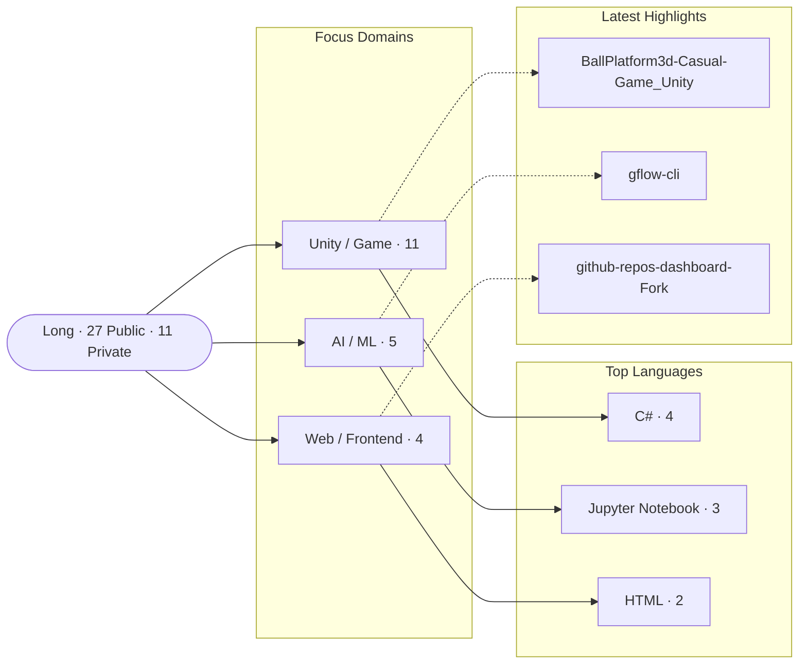

  

📍 VietNamese &nbsp;·&nbsp; 📦 38 repos (27 public · 11 private) &nbsp;·&nbsp; 🕒 Synced 2026-11-27

---

### 🧑‍💻 About & Focus

Building software across **🎮 Unity / Game** (11), **🤖 AI / ML** (5), **🌐 Web / Frontend** (4). Explore the full searchable catalog, charts, and interactive Knowledge Graph on the **[Web Dashboard](https://hathanhlong2002.github.io/github-repos-dashboard/)**.

| Domain | Public Repos | Share |
|--------|-------------:|-------|
| 🎮 Unity / Game | **11** | `█████░░░░░░░` 41% |
| 📁 Other | **7** | `███░░░░░░░░░` 26% |
| 🤖 AI / ML | **5** | `██░░░░░░░░░░` 19% |
| 🌐 Web / Frontend | **4** | `██░░░░░░░░░░` 15% |

### 🗺️ Ecosystem Map

### 🛠️ Tech Stack & Domains

**Languages**

      

**Engines, Frameworks & AI Tools**

  

### 🌟 Featured & Recent Projects

| Project | Category | Language | Highlights | Updated |
|---------|----------|----------|------------|---------|
| [**github-repos-dashboard-Fork**](https://github.com/Hathanhlong2002/github-repos-dashboard-Fork) | 🌐 Web / Frontend | `Python` | Automated GitHub repos dashboard and dynamic profile README | `2026-11-27` |
| [**github-repos-dashboard**](https://github.com/Hathanhlong2002/github-repos-dashboard) | 🌐 Web / Frontend | `HTML` | Automated overview & manager for all personal GitHub repositories. Helps the owner and… | `2026-11-10` |
| [**BallPlatform3d-Casual-Game_Unity**](https://github.com/Hathanhlong2002/BallPlatform3d-Casual-Game_Unity) | 🎮 Unity / Game | `ShaderLab` | unity 3d casual game | `2026-10-18` |
| [**gflow-cli**](https://github.com/Hathanhlong2002/gflow-cli) | 🤖 AI / ML | `TypeScript` | GFlow CLI — Command-line tool that automates Google Flow in your local Chrome browser.… | `2026-10-14` |
| [**wxt**](https://github.com/Hathanhlong2002/wxt) | 📁 Other | `-` | ⚡ Next-gen Web Extension Framework | `2026-09-12` |
| [**UniTask**](https://github.com/Hathanhlong2002/UniTask) | 🎮 Unity / Game | `-` | Provides an efficient allocation free async/await integration for Unity. | `2026-09-12` |
| [**unity-mcp**](https://github.com/Hathanhlong2002/unity-mcp) | 🎮 Unity / Game | `-` | Unity MCP acts as a bridge between AI assistants and your Unity Editor. Give your LLM… | `2026-09-12` |
| [**unity-actions**](https://github.com/Hathanhlong2002/unity-actions) | 🎮 Unity / Game | `-` | Github actions for testing and building Unity projects | `2026-09-12` |
| [**ml-agents**](https://github.com/Hathanhlong2002/ml-agents) | 🎮 Unity / Game | `-` | The Unity Machine Learning Agents Toolkit (ML-Agents) is an open-source project that… | `2026-09-12` |
| [**playwright-mcp**](https://github.com/Hathanhlong2002/playwright-mcp) | 📁 Other | `-` | Playwright MCP server | `2026-09-12` |

👉 <a href="https://hathanhlong2002.github.io/github-repos-dashboard/">Explore all 27 public repos, charts &amp; interactive Knowledge Graph on the Web Dashboard</a>

### 🔒 Private Projects (11)

| Repo | Purpose |
|------|---------|
| **3D-Asset-Unity** | Save some asset 3d unity can used |
| **Build-Home** | Build Home 3d |
| **Cat-find-Home** | - |
| **Craw-Data-industryGroup** | craw data product from industry group |
| **HTL2910** | No |
| **muse-5-nghien-cuu-thi-truong-va-tao-mot-app-doc** | Muse Company · nhiệm vụ #5: nghiên cứu thị trường và tạo một app đôc đáo giải quyết nỗi đau của người dùng để đưa lên google play store |
| **MuseCompanAITeam** | Công ty AI nhiều tài khoản Muse: chia việc theo sơ đồ công ty, hỏi đáp, duyệt bài, CEO báo cáo |
| **react-native-demo** | - |
| **ReactNative** | - |
| **SwiftUI** | - |
| **test-lai-hocSai1** | Hoc Unity |

### 📊 GitHub Analytics

  <picture><source media="(prefers-color-scheme: dark)" srcset="https://github-readme-stats.vercel.app/api?username=Hathanhlong2002&show_icons=true&include_all_commits=true&count_private=true&theme=tokyonight&hide_border=true&bg_color=0d1117&cache_bust=202611271025"><source media="(prefers-color-scheme: light)" srcset="https://github-readme-stats.vercel.app/api?username=Hathanhlong2002&show_icons=true&include_all_commits=true&count_private=true&theme=default&border_color=d0d7de&bg_color=ffffff&title_color=1d4ed8&icon_color=4f46e5&cache_bust=202611271025"></picture>
  <picture><source media="(prefers-color-scheme: dark)" srcset="https://github-readme-stats.vercel.app/api/top-langs/?username=Hathanhlong2002&layout=compact&langs_count=8&theme=tokyonight&hide_border=true&bg_color=0d1117&cache_bust=202611271025"><source media="(prefers-color-scheme: light)" srcset="https://github-readme-stats.vercel.app/api/top-langs/?username=Hathanhlong2002&layout=compact&langs_count=8&theme=default&border_color=d0d7de&bg_color=ffffff&title_color=1d4ed8&cache_bust=202611271025"></picture>

  <picture><source media="(prefers-color-scheme: dark)" srcset="https://github-profile-trophy.vercel.app/?username=Hathanhlong2002&theme=tokyonight&no-frame=true&no-bg=true&row=1&column=6&margin-w=6&cache_bust=202611271025"><source media="(prefers-color-scheme: light)" srcset="https://github-profile-trophy.vercel.app/?username=Hathanhlong2002&theme=flat&no-frame=true&no-bg=true&row=1&column=6&margin-w=6&cache_bust=202611271025"></picture>

---

